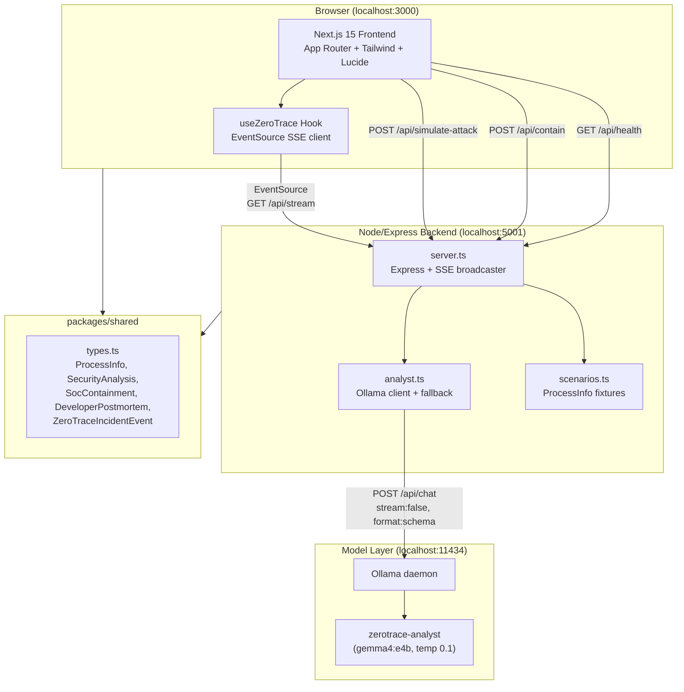
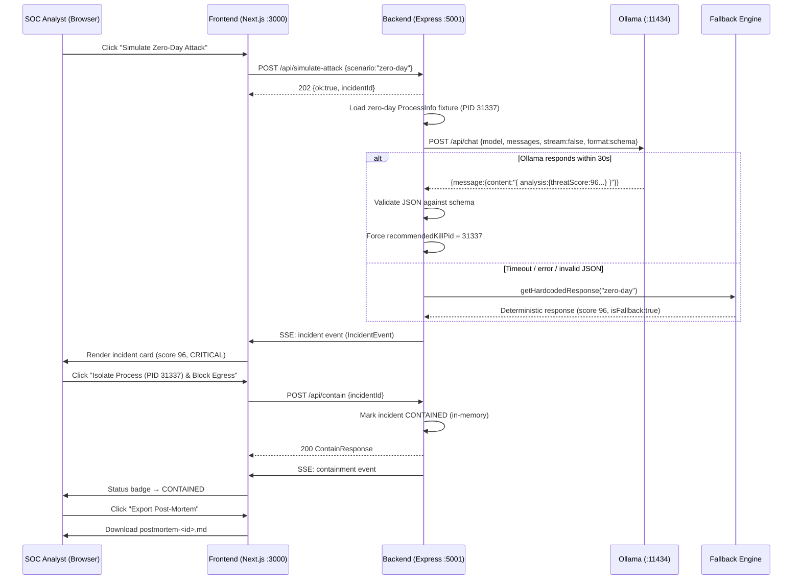
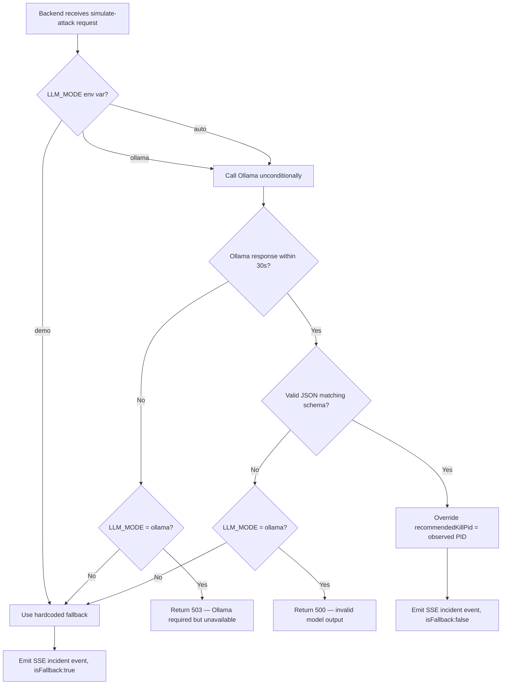
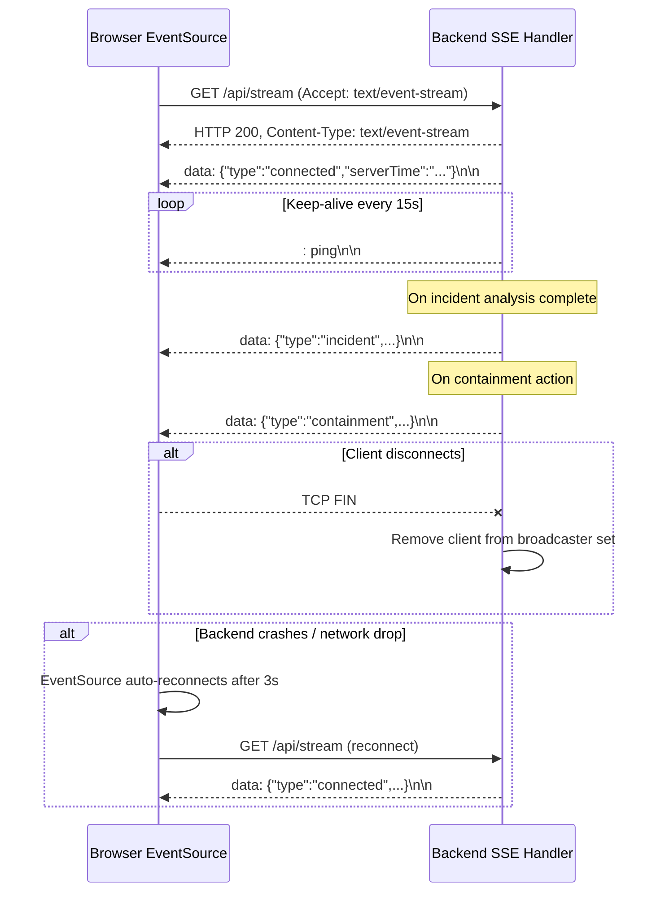

# ARCHITECTURE.md — ZeroTrace System Architecture

---

## (a) Component Diagram

---

## (b) Zero-Day Demo Sequence

---

## (c) Fallback and Timeout Decision Flow

---

## (d) SSE Lifecycle

---

## Environment Variables

| Variable | Default | Description |
|----------|---------|-------------|
| `LLM_MODE` | `auto` | `demo` = always fallback, `ollama` = error if unavailable, `auto` = try then fallback |
| `OLLAMA_HOST` | `http://localhost:11434` | Ollama daemon base URL |
| `OLLAMA_MODEL` | `zerotrace-analyst` | Model name to call (after `ollama create`) |
| `OLLAMA_TIMEOUT_MS` | `30000` | Max wait time for model response (ms) |
| `OLLAMA_KEEP_ALIVE` | `10m` | How long to keep model resident in memory |
| `PORT` | `5001` | Backend Express port |
| `FRONTEND_ORIGIN` | `http://localhost:3000` | Allowed CORS origin |
| `NEXT_PUBLIC_API_URL` | `http://localhost:5001` | Frontend: backend base URL |

---

## Trust Boundaries

| Boundary | Rule |
|----------|------|
| Model JSON output | Validated against `zerotrace-incident.schema.json` before use |
| `recommendedKillPid` | Backend overwrites with observed `ProcessInfo.pid` — model cannot target arbitrary PIDs |
| Command line content | Never passed to a shell (`exec`, `spawn`). Always treated as a string/data. |
| Prompt injection | Command line is wrapped in `<PROCESS_COMMANDLINE>…</PROCESS_COMMANDLINE>` delimiters; system prompt instructs model to treat the content as data |
| Containment actions | Simulated only — no OS signals sent, no firewall rules changed |
| Ollama host | Configurable but defaults to localhost — no external LLM calls |
