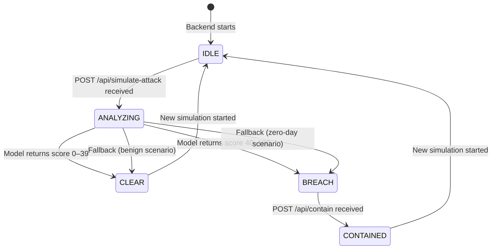

# FLOW.md — ZeroTrace User, Event, and State Flows

---

## 1. Analyst User Flow

```
[Open Dashboard]
       │
       ▼
[SSE connects → status: IDLE — No Active Threats]
       │
       ▼
[Click "Simulate Zero-Day Attack"]
       │
       ▼
[Status: ANALYZING… (spinner)]
       │
       ├── ≤ 30 s ──► [Incident card appears]
       │                     │
       │               [Score ≥ 75?]
       │                  YES │          NO
       │                      │          ▼
       │                      │    [SAFE card — containment button disabled]
       │                      ▼
       │              [Containment button ENABLED]
       │                      │
       │               [Click "Isolate Process (PID 31337) & Block Egress"]
       │                      │
       │               [POST /api/contain]
       │                      │
       │               [Status: CONTAINED]
       │                      │
       │               [Click "Export Post-Mortem"]
       │                      │
       │               [Download postmortem-<id>.md]
       │
       └── > 30 s ──► [Timeout → fallback response (⚡ badge) → same flow]
```

---

## 2. Developer User Flow

```
[Receive notification / alert from SOC analyst]
       │
       ▼
[Open dashboard or receive exported .md file]
       │
       ▼
[Read post-mortem: title, description, actionItems]
       │
       ▼
[File GitHub Issue / Jira ticket from the .md content]
       │
       ▼
[Address action items:]
       ├── Audit npm dependencies for compromise
       ├── Rotate AWS credentials immediately
       ├── Add file-access monitoring to CI
       └── Pin vulnerable dependency to safe version
```

---

## 3. Event Flow

```
Browser                    Backend (Express)              Ollama
──────                     ────────────────               ──────

EventSource ──GET /api/stream──► SSE handler
                                 │
                                 ◄─── data: connected ────
                                 │
POST /api/simulate-attack ──────►│
                                 │── load ProcessInfo ───►
                                 │── POST /api/chat ─────────────────────► Ollama
                                 │                                          │
                                 │◄─────────── JSON response ─────────────
                                 │
                                 │── validate JSON schema
                                 │── override killPid
                                 │
                                 ◄─── data: incident ─────
                                 │
POST /api/contain ──────────────►│
                                 │── mark CONTAINED (in-memory)
                                 ◄─── HTTP 200 ContainResponse ───────────
                                 ◄─── data: containment ──────────────────
```

---

## 4. Incident Posture State Machine



**Notes:**
- Only one active incident at a time (demo scope).
- Starting a new simulation while BREACH/CONTAINED resets the state to IDLE then ANALYZING.

---

## 5. Error Flows

### 5.1 Backend Down

```
Browser:
  EventSource retries every 3 s
  Connection status indicator → RED
  All buttons disabled except "Reconnect"

Recovery:
  Restart backend → EventSource reconnects automatically
  "connected" SSE event re-enables the UI
```

### 5.2 SSE Connection Dropped Mid-Session

```
Browser:
  EventSource.onerror fires
  Status indicator flashes RED
  Auto-reconnect after 3 s
  On reconnect, server sends "connected" event
  In-memory incident state is NOT replayed (demo scope — refresh if needed)
```

### 5.3 Ollama Not Running

```
Backend:
  LLM_MODE = auto → fall back to deterministic response, isFallback: true
  LLM_MODE = ollama → return HTTP 503 {"error":"Ollama unreachable"}
  GET /api/health → {"status":"degraded","ollamaReachable":false}

Frontend:
  Health check on mount → show amber banner "⚠️ Ollama offline — demo mode active"
```

### 5.4 Model Not Pulled

```
Backend:
  POST /api/chat returns 404 (model not found)
  Treated the same as "Ollama error" → fallback in auto mode

Prevention:
  run setup-ollama.sh before demo
  GET /api/health checks model presence via GET /api/tags
```

### 5.5 Timeout (> OLLAMA_TIMEOUT_MS)

```
Backend:
  AbortController fires after OLLAMA_TIMEOUT_MS ms
  LLM_MODE auto → use fallback response
  Log: WARN [analyst] Ollama timeout after 30000ms — using fallback

Frontend:
  Incident card appears with ⚡ badge within 30 s of simulation start
```

### 5.6 Invalid JSON from Model

```
Backend:
  JSON.parse throws → schema validation fails
  Log: WARN [analyst] Model returned invalid JSON — using fallback
  LLM_MODE auto → fallback
  LLM_MODE ollama → return 500 {"error":"Model returned invalid JSON"}
```

### 5.7 Contain on Unknown incidentId

```
Backend:
  POST /api/contain {incidentId:"unknown"}
  Response 404: {"ok":false,"message":"Incident not found"}

Frontend:
  Show toast: "Error: Incident not found. Refresh and try again."
```

### 5.8 Contain on Already-Contained Incident

```
Backend:
  POST /api/contain on CONTAINED incident
  Response 409: {"ok":false,"message":"Already contained"}

Frontend:
  Show toast: "This incident is already contained."
```
